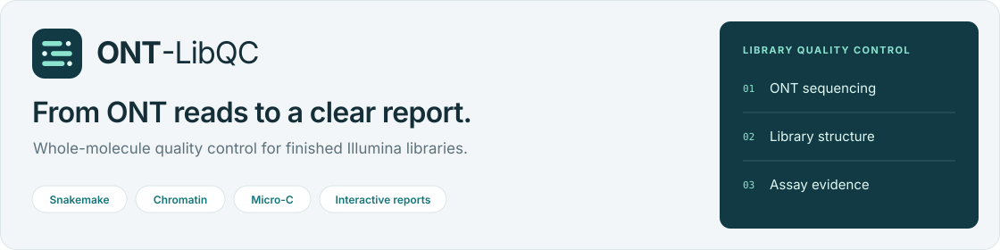

<p align="center">
  
</p>

<p align="center">
  <a href="#run-your-data"><strong>Run the workflow</strong></a> ·
  <a href="example_report/README.md">Example reports</a> ·
  <a href="portal/README.md">Host the web portal</a>
</p>

ONT-LibQC is a Snakemake workflow for quality control of completed Illumina chromatin and Micro-C libraries using shallow ONT sequencing. It reconstructs adapter-bounded library units, identifies physical index pairs, and produces an interactive HTML report.

## Example report

**[Open the example report](example_report/index.html)**

Download or clone the repository, then open `example_report/index.html` in your browser. The report is already generated and works locally. GitHub's file view displays the HTML source.

| Sample | Library | Reference | Explore |
| --- | --- | --- | --- |
| [HL240](example_report/samples/HL240.html) | Chromatin | hg38 | Library profiles, gene coverage and local BED regions |
| [HL120](example_report/samples/HL120.html) | Micro-C | dm6 | Contacts, ligation structure and MNase size evidence |

Explore library size profiles, gene coverage, local BED uploads, contact metrics, ligation structure and MNase size evidence. Figures and downloadable report data for both samples are included.

## Web portal

A self-hosted interface accepts up to 16 FASTQ files per batch (50 MB each), with per-file settings, private task links, optional email notification and direct sample-report downloads. Limits are adjustable in one server configuration file; bounded, isolated jobs run sequentially. The reference preparation script includes a default list of ten common species. See [deployment, security and reference preparation](portal/README.md) for installation on your own server and migration instructions.

## Run your data

```bash
conda env create -f environment.yaml
conda activate ont-library-qc
cp config.example.yaml config.yaml
# Edit FASTQ paths, assay types, references and optional screens.
snakemake --cores 8 --rerun-incomplete
```

Run commands from the directory containing `Snakefile`. The default target is `all`.

- `samples.<name>.fastq`: one FASTQ path or a list, plain or gzip compressed.
- `samples.<name>.type`: `chromatin` or `microc`.
- `references`: FASTA, chromosome sizes, GTF annotation, prebuilt mapper indexes and primary chromosome names. Optional `minimap2_index` reuses a `.mmi` prepared with `-k 9 -w 5`.
- `samples.<name>.custom_regions`: optional BED, assembly and label. Chromatin reports also accept a BED in the browser.
- `spike_in` / `mycoplasma_screen`: optional competitive screens; supply prepared reference indexes before enabling them.
- `params` / `qc_reference_ranges`: analysis settings and local screening cutoffs; see [metric definitions](workflow/scripts/metric_definitions.json).
- `tools`: optional executable overrides; otherwise commands are found on `PATH`.

## Output

Open `report/index.html` after the run. Copy the entire `report/` folder to share it. BED uploads and plot exports run locally in the browser.

| Location | Contents |
| --- | --- |
| `report/index.html` | All-sample overview |
| `report/samples/` | Sample reports and sublibrary results |
| `report/assets/` | Figures and figure source tables |
| `report/data/` | QC metrics, adapter/index tables, screens, ligation and MNase evidence |
| `report/downloads.html` | All downloadable report data |

All calculation intermediates go to `output_dir` (default `.work`). After the report is generated and its links are checked, the workflow removes BAM/BAI, SAM, extracted FASTQ, coverage tracks, matrices and the working directory. Failed runs retain working files for resumption. Original FASTQ and supplied references are preserved.

Set `report_dir` to change the report location. It must be separate from `output_dir`; both directories must be outside the input/reference paths. Recomputing a completed analysis requires the original inputs because calculation intermediates have been removed.
