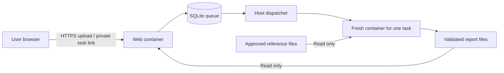

<p><a href="../README.md"></a></p>

[ONT-LibQC](../README.md) / Web portal · [Example reports](../example_report/README.md)

# ONT-LibQC web portal

A self-hosted upload and reporting interface for this Snakemake workflow. Each FASTQ has an independent configuration, private task link, and downloadable report. The results page links directly to each sample report; online report bundles contain no all-sample summary page or overview figure. The included HL240 chromatin and HL120 Micro-C examples are available without submitting a job. Micro-C reports include Pairtools UU, UR/RU, DD, WW and Other fractions with downloadable counts and per-unit evidence; promoter/gene/distal pies are shown only for chromatin libraries.

Users can upload `.fastq`, `.fq`, `.fastq.gz` or `.fq.gz`, enter an email address, and choose the assay, prepared reference, mapper, optional screens, expected index pairs, primary chromosomes, BED regions, analysis parameters and report cutoffs. POD5 and FAST5 require basecalling before upload. Server paths, executable names, reference URLs and resource limits are controlled by the operator.

Each newly uploaded file starts with **Choose reference genome…** and **Choose library assay…**. Both fields are highlighted until explicitly selected and are required before submission. No reference or assay is preselected. With multiple files, choose both fields on any file and click **Apply to all** to copy that reference and assay to the other libraries in the current upload selection. Individual files can still be adjusted afterward. Sample names and other settings are not copied; changing a reference resets BED coordinate confirmation and updates reference-dependent screens, and changing an assay updates the compatible analysis controls.

For each newly uploaded file, Mycoplasma and spike-in / foreign-sequence screens are selected by default when the chosen reference has a prepared panel. Users can turn either screen off; their choices are retained when switching references. Unavailable screens remain disabled. The separate declaration that a spike-in was intentionally added is not selected automatically.

Reports distinguish the BED submitted with the original analysis from additional BED files analyzed in the browser. New submissions preserve the original BED filename; older reports that did not retain it say so. Both the submission form and report provide **Plot mode** (`Auto`, `Reference point` or `Region (scaled)`) and require confirmation that the BED uses the selected reference coordinates. Choosing another BED clears the previous browser result and resets coordinate confirmation; click **Draw metaplot** to analyze it. The submitted plot remains available for comparison.

The online report footer and Report data page provide **Download complete report (ZIP)**, containing the saved HTML report, figures, tables and settings. Extract it and open `report/index.html`; keep the folder together. Additional browser-generated metaplots are saved with their own result controls and are not added to the server’s saved ZIP.

Open a report through its complete private task link, including the part after `#`. After authorization, the browser retains read-only access until the report expires, and figure links open in new tabs. If an older session has expired, or you switch browsers, reopen the private task link from your email or saved links. A report URL without an access key or an authorized browser session shows guidance for reopening that private link.

## Deployment on a Linux server

Requirements: Docker Engine and Compose, Python 3.11 or later with venv support, OpenSSL, and systemd user services. The dispatcher runs as an ordinary user with Docker access. Use a dedicated service account on a shared production server. Do not mount the Docker socket into the public web container.

Run the following from the repository root:

```bash
python3 -m venv /srv/ont-qc/venv
/srv/ont-qc/venv/bin/pip install -r portal/requirements.txt

docker build -f portal/deploy/Dockerfile.runner -t ont-qc-runner:1 .
docker build -f portal/deploy/Dockerfile.web -t ont-qc-web:1 .
```

Choose a runtime directory writable by the service account; `/srv/ont-qc` is an example. Keep it outside the source tree. Building the runner installs the pipeline's aligners, fastp, Pairtools, Snakemake, plotting tools, R and karyoploteR. Rebuild the runner image when upgrading a deployment that predates the Pairtools analysis, then update `runner_image` in the compute worker settings and restart the idle worker.

Prepare or adopt references as described below, then initialize the deployment:

```bash
/srv/ont-qc/venv/bin/python portal/scripts/service.py init \
  --runtime /srv/ont-qc/runtime \
  --catalog /srv/ont-qc/references/common/catalog.admin.json \
  --public-url https://qc.example.org:8443 --port 8443 \
  --cert /path/to/fullchain.pem --key /path/to/privkey.pem

/srv/ont-qc/venv/bin/python portal/scripts/service.py up \
  --runtime /srv/ont-qc/runtime
loginctl enable-linger "$(id -un)"
```

The initializer generates an optional submission code in `runtime/secrets.json`. Share that code with invited users. Add `--open-submissions` to initialization if you want bounded public submissions without a code. Private report access is always enforced independently of the submission code.

With no domain or certificate, use an HTTPS IP origin, such as `https://192.0.2.10:8443`, and omit `--cert`/`--key`. This creates a **30-day self-signed certificate for initial evaluation**. Browsers will not trust it automatically. Before general external use, install a certificate trusted by your users; do not ask users to disable certificate verification. Distribute a self-signed certificate only through a separate trusted channel if it must be used within a controlled group. Certificate renewal/replacement is the operator's responsibility. After replacing certificates, run `service.py harden` to refresh the backend CA bundle, then recreate both web and edge containers.

Only the Nginx edge container publishes a port. It handles TLS, limits requests and connections, and closes incomplete headers after 10 seconds. The web application is on a separate internal Docker network with no published port. Edge-to-web traffic uses verified TLS. The edge overwrites forwarded client headers using its socket peer; the backend trusts these headers only because this network contains the trusted edge and web containers. Do not attach untrusted containers or publish the backend port. Reports, credentials and upload bodies are not logged by the proxy.

Existing deployments can adopt the same layout without moving data or rebuilding references:

```bash
python portal/scripts/service.py harden --runtime /srv/ont-qc/runtime
docker compose -f /srv/ont-qc/runtime/compose.yaml up -d --force-recreate web edge
```

Build the updated web image before applying a source upgrade and retain the existing signing key. `harden` preserves the configured web image, public port and bind address, writes `edge.conf` and a certificate trust bundle, and configures the small `nginx:stable-alpine` container. Run it again after changing limits or certificates. Public TLS and internal backend TLS use separate certificates; the latter has a fixed verified DNS identity even when the public address is an IP. Apply web updates when no files are actively uploading; running analysis containers are independent.

For access through ZeroTier, point the domain's DNS record to the server's ZeroTier address and add `--bind <server-zerotier-ip>` when initializing. Use the domain in `--public-url`, with the chosen HTTPS port. Clients must belong to the authorized ZeroTier network and be able to reach that address. Binding to the ZeroTier address limits the published port to that interface; certificate trust is still required.

To change an existing deployment's address, update `public_url` and `allowed_hosts` in both `web.yaml` and `worker.yaml`, update the host address in `compose.yaml` under `ports`, and install a certificate covering the new hostname. Keep `secrets.json` unchanged to preserve private task credentials. Apply the change when no jobs are active with `docker compose -f /srv/ont-qc/runtime/compose.yaml up -d --force-recreate web edge` and `systemctl --user restart ont-qc-portal-worker.service`. Existing task links need their origin changed to the new URL while retaining the path and fragment.

## Reference and index preparation

To adopt already prepared references without copying or rebuilding them:

```bash
/srv/ont-qc/venv/bin/python portal/scripts/prepare_references.py adopt \
  --config /path/to/existing/config.yaml \
  --output /srv/ont-qc/references/common/catalog.admin.json
```

This reads reference settings only. It does not copy samples, raw reads, tools or reports from the source configuration. It checks that the FASTA, annotation, chromosome sizes, and complete Bowtie2 and BWA-MEM2 index sets are present. Optional Mycoplasma and spike-in panels are exposed only when their indexes are ready. Symlinked reference FASTA files retain the correct BWA index prefix.

For a new server, the default source list is ready to download. Run:

```bash
/srv/ont-qc/venv/bin/python portal/scripts/prepare_references.py build \
  --output /srv/ont-qc/references/common --threads 2
```

The operator script downloads the reference FASTA and matching GTF over HTTPS. Docker containers build chromosome sizes and Bowtie2, BWA-MEM2 and Minimap2 indexes with networking disabled. Prepared files live in the output directory outside the Docker images, so they persist across container upgrades and can be mounted read-only by analysis jobs. Starting the portal itself does not download references; initialize it with the generated `catalog.admin.json` after preparation completes.

The [default source list](deploy/references.common.yaml), verified against NCBI on 2026-09-11, contains one current annotated RefSeq reference per species:

| Species | Assembly | NCBI reference |
| --- | --- | --- |
| Human | GRCh38.p14 | [GCF_000001405.40](https://www.ncbi.nlm.nih.gov/datasets/genome/GCF_000001405.40/) |
| Mouse | GRCm39 | [GCF_000001635.27](https://www.ncbi.nlm.nih.gov/datasets/genome/GCF_000001635.27/) |
| Rat | GRCr8 | [GCF_036323735.1](https://www.ncbi.nlm.nih.gov/datasets/genome/GCF_036323735.1/) |
| Fruit fly | Release 6 plus ISO1 MT | [GCF_000001215.4](https://www.ncbi.nlm.nih.gov/datasets/genome/GCF_000001215.4/) |
| C. elegans | WBcel235 | [GCF_000002985.6](https://www.ncbi.nlm.nih.gov/datasets/genome/GCF_000002985.6/) |
| Zebrafish | GRCz12ab | [GCF_052040795.1](https://www.ncbi.nlm.nih.gov/datasets/genome/GCF_052040795.1/) |
| Budding yeast | R64 | [GCF_000146045.2](https://www.ncbi.nlm.nih.gov/datasets/genome/GCF_000146045.2/) |
| Fission yeast | ASM294v3 | [GCF_000002945.2](https://www.ncbi.nlm.nih.gov/datasets/genome/GCF_000002945.2/) |
| Arabidopsis | TAIR10.1 | [GCF_000001735.4](https://www.ncbi.nlm.nih.gov/datasets/genome/GCF_000001735.4/) |
| Rice | AGIS1.0 | [GCF_034140825.1](https://www.ncbi.nlm.nih.gov/datasets/genome/GCF_034140825.1/) |

A newer assembly without matching annotation is excluded until it can support the full report. For example, the current annotated zebrafish reference is GRCz12ab; GRCz13ab does not yet have a matching RefSeq annotation. The manifest pins assembly accessions and records annotation releases. Update those sources deliberately when adopting a future release. Historical alternatives such as hg19 and mm10 are omitted.

Use `--only hg38 dm6` to prepare a subset, or `--sources /path/to/sources.yaml` with [the custom template](deploy/references.example.yaml). FASTA and GTF chromosome names from the common list are normalized together using NCBI assembly reports; generated `chrom.sizes` and the catalog show the names accepted by BED uploads.

Reference preparation is sequential, starting with smaller genomes. It defaults to 2 CPUs, with a memory cap estimated separately for each tool and genome. Bowtie2 uses larger blocks to reduce repeated genome scans while retaining that memory cap. `--memory 96g` is the maximum permitted build allocation, not the allocation for every reference. BWA-MEM2 indexing needs approximately 28 bytes per genome base plus overhead, so a new human-sized reference requires roughly 80–90 GiB during this one-time step. The script checks available memory with 16 GiB reserved by default and fails before launching an undersized build. The portal's analysis limits remain controlled separately by `limits.yaml`.

Completed references are reused. Interrupted builds keep `.building-<reference>` and `build.log`; rerun the same command to resume completed download/index steps. Changed source settings require a new output directory. Each completed reference is recorded in the generated catalog; unfinished references are never marked ready. Do not replace indexes used by active analysis jobs.

To reuse your own already prepared, assembly-compatible references, add `--reuse-catalog /path/to/catalog.admin.json`. Their original annotation and screening settings are retained. Source URLs, file paths and preparation commands are controlled exclusively by the operator. Uploaded files cannot request downloads or builds.

Minimap2 indexes use the workflow's existing short-unit settings (`-k 9 -w 5`) and contain the full reference in one index. Online jobs load this prepared index instead of rebuilding it for every submission. Its header is checked for compatible parameters; runtime memory is based on index size plus reserved overhead and remains subject to the 20 GiB online cap. Index preparation and online resource caps are independent. See the [Minimap2 indexing options](https://lh3.github.io/minimap2/minimap2.html) for how saved indexes retain their settings.

The default `build` command prepares all three aligners. To add Minimap2 indexes to an existing administrator catalog:

```bash
/srv/ont-qc/venv/bin/python portal/scripts/prepare_references.py minimap2 \
  --catalog /srv/ont-qc/references/common/catalog.admin.json \
  --output /srv/ont-qc/references/minimap2 --threads 2
```

Use the generated `catalog.admin.json` when initializing or updating the portal. An adopted reference without a matching Minimap2 index still supports its prepared Bowtie2 and BWA-MEM2 modes. The optional `minimap2_index` field in a workflow configuration points to the saved `.mmi` file; standalone CLI runs retain the FASTA fallback when it is omitted.

Optional host-competitive Mycoplasma and spike-in panels remain operator-configured in the custom source template. A newly prepared genome has these options disabled until a matching panel is provided; the script does not substitute another species' screen.

No file checksum inventory or report hash verification is used. File types, bounded sizes, index file sets, report links and paths are checked. HMAC is used solely to authenticate private task links and pseudonymize rate-limit identifiers.

## Isolation and data handling



The public container has no pipeline tools, reference mounts, Docker socket or compute work directory. It writes only incoming uploads and task metadata, and reads published reports. The dispatcher validates stored options again, takes a private copy of each regular uploaded file without following symlinks, and launches a fresh container for that job.

Every compute container has its own working directory, no network, a read-only root filesystem, no Linux capabilities, `no-new-privileges`, and CPU/memory/process/file-size limits. It sees only that job's input, the workflow source, and approved reference directories mounted read-only. It does not receive the task database, signing key, email, SMTP credentials or other users' files. The trusted host dispatcher has Docker access; compromise of that dispatcher or the host is outside the container isolation boundary.

FASTQ and gzip validation runs inside the isolated container, checks four-line records, IDs, sequence/quality lengths and characters, duplicate IDs, expanded size and read count. BEDs are normalized to coordinate columns and checked against the chosen assembly. Configuration fields are allowlisted and bounded; users cannot submit arbitrary YAML, regexes, shell commands, paths or URLs.

Task access uses unguessable authenticated links. The long-lived task credential is in the URL fragment, then sent in an Authorization header; it is not in the HTTP URL or access logs. Opening an authorized report sets a separate HttpOnly, Secure, SameSite=Lax, report-scoped read-only cookie until the report expires. It supports safe top-level figure and download navigation without giving access to task operations. The server renews local resource links with read-only grants lasting at most one hour on each authorized HTML navigation, so sandboxed documents can load figures without relying on third-party cookies. Neither report credential can read task metadata, cancel jobs or create submissions. A report URL without a valid browser session or grant directs the visitor to instructions for opening their complete private task link. These short-lived grants appear in report asset URLs; access logs are disabled and any added proxy must omit query strings from its logs. No-referrer and no-store headers also apply. Downloaded ZIP files retain ordinary portable relative links. Report HTML is served with a sandbox Content Security Policy that prevents same-origin privileges and external connections, while allowing figure links to open in sandboxed tabs. Application HTML uses separate local scripts, no third-party analytics, and a stricter CSP. CSRF/origin checks, size limits, queue limits and per-address/per-client daily quotas apply to submissions. SQLite writes use transactions and parameterized queries.

Both services load operator settings from one private `runtime/limits.yaml`. New deployments include the 24 common upload, queue, storage and compute settings. Omitted HTTP, temporary-filesystem and logging settings use the shared defaults in [limits.py](ont_portal/limits.py); they can still be added to `limits.yaml` to override those defaults. Existing full configuration files remain supported. Effective defaults are:

| Setting | Default |
| --- | --- |
| FASTQ upload | 50 MB per file (50,000,000 bytes) |
| Files per batch | 16, reserved together in one transaction |
| Expanded FASTQ | 250 MB / 250,000 reads |
| BED upload | 4 MiB / 100,000 regions |
| Concurrent compute jobs | 2 across local and remote submissions; rules remain serial within each job |
| Ordinary job resources | 2 CPUs / 8 GiB RAM / 128 processes |
| Large BWA-MEM2 / Minimap2 indexes | Index-aware memory budget, capped at 20 GiB |
| Web service | 0.5 CPU / 256 MiB RAM |
| Public edge | 0.25 CPU / 64 MiB RAM; 128 connections including upstream connections |
| Dispatcher service | 0.5 CPU / 512 MiB RAM |
| Runtime per job | 1 hour |
| Work files per job | 4 GiB monitored total / 1 GiB hard per-file limit |
| Job temporary filesystem | 512 MiB |
| Pending or running tasks | 32 globally; 16 per email or client address |
| Incoming reservations | 2 GB, including optional BED reservations |
| Minimum free disk | 10 GiB, plus the work allowance before starting a job |
| Free host memory before a job | Its budget plus other active reservations and 2 GiB |
| Submissions per email/client | 128 per 24 hours, including later deleted tasks |
| Concurrent HTTP requests / uploads | 16 / 10 globally; 8 / 1 per client |
| HTTP request rate | 360/min per client, burst 120; 1,200/min globally, burst 160 |
| New submission requests at edge | 6/min per IP, burst 4; each batch can contain 16 files |
| Incomplete request headers | 10 seconds at edge |
| Upload request / idle timeout | 10 minutes / 20 seconds |
| Unfinished batch upload expiry | 3 hours after creation |
| Report size | 100 MiB per bundle; HTML pages at most 4 MiB |
| Total published report storage | 2 GiB |
| Administrator log | 10 MiB hard file-size limit per job |
| Report retention | 7 days after completion |

The batch endpoint accepts the entire batch or rejects it without creating any jobs. The browser uploads files sequentially, waits and retries when upload capacity is occupied, restores all batch links after a refresh, and polls active tasks every 10 seconds (30 seconds in a hidden tab). Completed tasks are checked only when their report session needs refreshing. Rate-limited polling pauses according to `Retry-After` and adds jitter; it does not retry a non-idempotent submission automatically. The dispatcher holds an exclusive supervisor lock and launches at most two isolated job processes. A transactional claim checks the global task count and reserves the combined memory, work disk and report capacity before starting another task. It waits for memory, disk and report-storage headroom before claiming the next task. Per-job containers enforce CPU, RAM, swap and process caps. BWA-MEM2 and Minimap2 jobs estimate their memory budget from the selected reference index: small genomes use the 8 GiB default, while larger genomes can require up to 20 GiB. Default chromatin jobs use Bowtie2 with the smaller budget. The service does not change the chosen aligner to save memory.

For files above the online limits, the UI links to [ONT-LibQC on GitHub](https://github.com/Shall-We-Dance/ONT-LibQC). Repository access is required until it is made public. `pipeline_url` in the same limits file controls this link.

To change upload or batch limits later, edit `runtime/limits.yaml` rather than frontend code, then regenerate edge configuration with `service.py harden`. For example:

```yaml
max_upload_bytes: 50000000
max_files: 16
max_pending_per_client: 16
max_pending: 32
max_jobs_per_day: 128
max_concurrent_jobs: 2
max_concurrent_uploads: 10
max_uploads_per_client: 1
cores: 2
memory: 8g
max_memory: 20g
```

`max_files` can be set from 1 to 64. Keep `max_pending_per_client`, `max_pending` and `max_jobs_per_day` at least as large as `max_files`, and allow enough `max_reserved_bytes` for the intended queue. Increasing a batch limit does not increase compute concurrency. `max_concurrent_jobs` controls the analysis ceiling; `max_concurrent_uploads` controls the global upload ceiling and `max_uploads_per_client` controls fairness. Gzip expansion and read-count limits remain independent. Apply changes when no tasks are active by recreating the web container and restarting the worker:

```bash
docker compose -f /srv/ont-qc/runtime/compose.yaml up -d --force-recreate web edge
systemctl --user restart ont-qc-portal-worker.service
```

CPU, memory, process count and per-file size are hard container limits. Aggregate work-directory size is checked periodically; use filesystem/project quotas as well if your deployment requires a strict aggregate disk limit. Rate limits are not a substitute for institution-wide traffic filtering or DDoS protection. A submission code can restrict expensive analyses to invited users. Keep one Uvicorn process and one dispatcher per runtime; the in-memory HTTP concurrency and request-rate limits are per process. IPv6 application quotas use a /64 network to reduce address-rotation bypass. The edge also enforces global request and connection bounds before forwarding to the application. The web container also limits open file descriptors to 512 to bound connection overhead. Admission quotas persist in SQLite, survive report deletion and service restarts, and retain pseudonymous counters for only 24 hours.

Successful, failed and cancelled jobs all remove their uploaded reads and calculation directory. Only successful report artifacts and bounded administrator logs remain. No BAM/SAM/FASTQ or alignment intermediates are offered in report downloads. Expired reports and logs are removed automatically; the retained task tombstone has its email, original filename, configuration and client identifier removed. Users can request earlier report deletion from their task page. A service interruption fails the active task safely; queued tasks survive restart. An interrupted upload can be cancelled and resubmitted.

Security design references: [OWASP denial of service](https://cheatsheetseries.owasp.org/cheatsheets/Denial_of_Service_Cheat_Sheet.html), [Nginx request limits](https://nginx.org/en/docs/http/ngx_http_limit_req_module.html), [OWASP file uploads](https://cheatsheetseries.owasp.org/cheatsheets/File_Upload_Cheat_Sheet.html), [OWASP CSRF prevention](https://cheatsheetseries.owasp.org/cheatsheets/Cross-Site_Request_Forgery_Prevention_Cheat_Sheet.html), [Docker service controls](https://docs.docker.com/reference/compose-file/services/).

## Progress updates

The browser reports FASTQ upload progress from the number of bytes sent. Once queued, analysis progress comes from the number of completed Snakemake steps. The worker samples that log approximately every 3 seconds and saves status and progress in its local SQLite database. Steps have different runtimes, so the percentage does not estimate elapsed or remaining time and can pause during a long step.

In a split deployment, the compute host's SSH bridge synchronizes status to the frontend database on each cycle, with a 5-second pause between cycles. File transfers and connection retries can extend that interval. The browser queries its authenticated task endpoint approximately every 10 seconds, or 30 seconds while its tab is hidden, with jitter and rate-limit backoff. Status survives browser refreshes and SSH interruptions. A running computation continues during a connection outage; the displayed state catches up after reconnection. A report is marked complete on the frontend only after its full bundle has arrived and passed publication checks.

## Email notification

Email is collected with a submission but **no email is sent unless SMTP is explicitly enabled**. Without SMTP, users must retain their private task links; the UI states this. This service has no email-based recovery endpoint.

Edit `runtime/smtp.yaml` on the server, set the host, port, sender and credentials, choose `starttls` (usually 587) or `ssl` (usually 465), and set `enabled: true`. Plaintext SMTP and disabled TLS certificate validation are not supported. Keep this file mode `0600` and out of Git. Set `mail_enabled: true` in `runtime/web.yaml` and in `runtime/frontend.yaml` (split deployment) or `runtime/worker.yaml` (single host), then recreate the web container.

For Resend, first verify the sending domain in its dashboard, then use `host: smtp.resend.com`, `port: 465`, `tls_mode: ssl`, `username: resend`, `password: YOUR_API_KEY`, `provider: resend`, and a sender such as `ONT-LibQC <reports@your-domain.org>`. A sending-only API key is sufficient. Disable open/click tracking for private report links. Do not place real credentials in source files or command-line arguments.

Also publish one DMARC TXT record in the sending domain’s DNS: name `_dmarc`, value `v=DMARC1; p=none;`, using the provider’s automatic TTL. For `reports@example.org`, the full record name is `_dmarc.example.org`. This initial policy does not request rejection or quarantine; keep the SPF and DKIM records configured for Resend. Confirm authentication across legitimate senders before adopting a stricter policy. DMARC belongs in DNS, not in `smtp.yaml`. See [Resend’s DMARC setup guide](https://resend.com/docs/dashboard/domains/dmarc).

On the frontend host, install the lightweight notification timer with the deployment's Python environment:

```bash
python portal/scripts/mail.py --runtime /srv/ont-libqc/runtime
```

Each submission receives **one summary email after all of its files reach a terminal state** (completed, failed, cancelled or expired), and successful reports are published. The email lists every file and its status, assay, reference, availability date and private task link, with one **View all results** button reopening the entire submission. Separate submissions remain separate even when they use the same email address. New batches are persisted when tasks are reserved, so fast completions cannot trigger premature individual messages. Existing tasks without batch metadata retain their original individual notification behavior; already sent messages are not sent again.

The timer runs every 30 seconds with a 96 MB memory ceiling. In a split deployment, c8 sends notifications only after the completed report is installed locally; the compute bridge keeps email disabled for imported tasks. Notifications contain the private task link, not sequencing files. Existing jobs created with email disabled are not sent retroactively.

Temporary failures retry after five minutes, at most five attempts. A process lock prevents competing senders, and Resend idempotency keys prevent duplicates within its 24-hour window. Ambiguous deliveries older than 23 hours stop retrying; generic SMTP cannot guarantee duplicate suppression after a connection failure. Permanently rejected deliveries stop immediately. A provider accepting mail does not guarantee inbox delivery. Inspect `mail_status` in the private task database and `journalctl --user -u ont-libqc-mail.service` for failures; logs omit recipients, links and credentials.

The message includes a plain-text alternative and a styled HTML body with the logo embedded as a small inline PNG. A compact result count and the primary report button appear above the library list. Each library has a clearly separated sample name, filename, status, assay/reference, report link and availability date; long filenames wrap within the email on narrow screens. It does not fetch remote images or attach sequencing data. Its button opens the private task page, where the report can be viewed or downloaded. The template escapes sample labels and uses stable MIME boundaries for retries. Batch retries share one attempt counter and idempotency key; the private MIME payload is frozen in the task database during retries and removed after delivery or expiration.

A logo inside the message is separate from the sender avatar shown by a mailbox app. Resend cannot set that avatar through SMTP. For Apple Mail, the domain/organization must complete [Apple Branded Mail verification](https://resend.com/blog/apple-branded-mail). Gmail branding requires [BIMI and a supported mark certificate](https://knowledge.workspace.google.com/admin/security/set-up-bimi). Public assets are available at `/static/brand-logo.png` and `/static/mail-logo.svg` for those provider setups; publishing an asset alone does not activate a verified inbox logo. A DMARC record does not activate a verified inbox logo; complete the separate BIMI or mailbox-provider branding requirements before claiming that verification.

## Domain HTTPS and automatic renewal

Install Certbot on the host and point the domain's A records at the frontend. Open inbound TCP 80 and 443. Port 80 serves only ACME validation and HTTPS redirects. With Cloudflare proxying enabled, use **Full (strict)**; keep HTTP ACME challenge paths exempt from any custom redirect/WAF challenge rules. No Cloudflare API key is required for HTTP validation.

Run as the deployment owner (not root), using the deployment's Python environment:

```bash
python portal/scripts/https.py prepare --runtime /srv/ont-libqc/runtime \
  --domain example.org --alias www.example.org --cloudflare --legacy-port 8443
# Add --docker-sudo above only when this host requires sudo for Docker.
docker compose -f /srv/ont-libqc/runtime/compose.yaml up -d --force-recreate web edge
python portal/scripts/https.py issue --runtime /srv/ont-libqc/runtime
python portal/scripts/https.py renew-timer --runtime /srv/ont-libqc/runtime
```

After issuance, set `public_url: https://example.org` and the domain in `allowed_hosts` in `web.yaml` and `frontend.yaml` (or `worker.yaml` on a single host); recreate web and edge. Preserve `secrets.json` and `state/` so private task links remain valid. The optional old IP port redirects to the domain, retaining the old IP certificate. Omit `--legacy-port` for a fresh domain deployment and omit `--cloudflare` when using DNS-only/direct hosting.

The Cloudflare option retrieves its official IP ranges, trusts `CF-Connecting-IP` only from those networks, and blocks direct access to the domain's application listener. Real client addresses still drive per-source admission limits. Re-run `prepare` and reload the edge when updating the trusted ranges. HTTP validation stays reachable from certificate authorities. Application and report responses use `Cache-Control: no-store`; do not add Cloudflare Cache Everything rules for the portal.

Certificates, ACME credentials and logs live in the private runtime directory. The public web container receives only its internal backend TLS key, not the public certificate's private key or SMTP credentials. The user timer checks renewal twice daily, reloads nginx after successful renewal, and survives logout/reboot when user lingering is enabled. To verify renewal independently:

```bash
certbot renew --dry-run --config-dir /srv/ont-libqc/runtime/acme \
  --work-dir /srv/ont-libqc/runtime/acme-work --logs-dir /srv/ont-libqc/runtime/acme-logs
systemctl --user list-timers ont-libqc-certificate.timer
```

Keep TCP 80 open for HTTP validation, or migrate renewal to a DNS challenge plugin if port 80 must be closed. After moving to another host, update DNS and runtime paths and reinstall the timers; do not copy old host paths blindly.


## Operations and migration

```bash
python portal/scripts/service.py status --runtime /srv/ont-qc/runtime
journalctl --user -u ont-qc-portal-worker.service --since today
python portal/scripts/service.py down --runtime /srv/ont-qc/runtime
```

`down` stops the services without deleting runtime data. The worker service and Docker restart policy survive logout; lingering must be enabled for automatic user-service startup after reboot. Docker Engine itself must be configured to start at boot.

To migrate to another Linux host:

1. Copy the repository and prepare Docker/Python as above. Build the two images, or transfer them using `docker save` / `docker load` for compatible CPU architectures.
2. Copy or rebuild reference files and indexes. Run `adopt` against paths valid on the destination host. Source code contains no server-specific reference paths.
3. For a fresh service, run `service.py init` with the destination URL, runtime directory and certificates.
4. To retain existing reports, stop the old service first, initialize destination settings, then copy its `state/` directory and **original `secrets.json`** to the destination runtime directory. Preserve the service user's file ownership and restrictive permissions. The signing key is required for existing private links. Do not overwrite the newly generated destination configuration with old machine paths. If the hostname changes, update the origin in links given to users.
5. Start the destination services, verify `/healthz` and a small job, and then route users to the destination.

Back up private reports and the signing key only if your retention policy permits it. Encrypt and restrict any such backups; do not include them in source control. The portable deliverables are the source, image definitions, reference preparation script and deployment configuration templates.


## Frontend and compute on separate hosts

A small frontend VM can host the public HTTPS UI, upload storage, task database and completed report downloads. The compute host retains all references and runs the same bounded dispatcher for both local and remote submissions. No reference or analysis image needs to be copied to the frontend.

On the frontend, copy this source tree and the compute host's **public** reference catalog, prepare the Python venv, and load/build the web image. Initialize the service with a frontend-only configuration:

```bash
/srv/ont-qc/venv/bin/python portal/scripts/service.py init \
  --runtime /srv/ont-qc/runtime --catalog /srv/ont-qc/catalog.public.json \
  --public-url https://203.0.113.10:8443 --port 8443 --bind 0.0.0.0 \
  --frontend-only --open-submissions
/srv/ont-qc/venv/bin/python portal/scripts/service.py up --runtime /srv/ont-qc/runtime
```

The example IP is a placeholder. Omit certificate arguments only for the intended self-signed evaluation deployment. Allow TCP 8443 in the cloud firewall only for the frontend instance. Keep SSH restricted to the compute host or administrator networks where possible. A frontend without a connected compute dispatcher refuses new submissions and continues serving existing task pages and reports.

On the compute host, configure an existing trusted SSH alias for the frontend, then install a dedicated restricted transfer key and the bridge:

```bash
python portal/scripts/connect_frontend.py --frontend frontend-ssh-alias \
  --runtime /srv/ont-qc/runtime --remote-root /srv/ont-qc
systemctl --user link /srv/ont-qc/runtime/ont-qc-remote-bridge.service
systemctl --user daemon-reload
systemctl --user enable --now ont-qc-remote-bridge.service
```

Run the connector using the compute worker's venv. The remote root must contain `source/`, `venv/` and `runtime/`. It installs a forced-command SSH key with shell, PTY and forwarding disabled. Private keys stay on the compute host; the public web container receives no SSH credentials. Enable user-service lingering on both hosts so the bridge and frontend retention timer survive logout and reboot. Use one bridge per compute runtime. Existing signing keys and private report links are preserved by ordinary code upgrades.

Transfers use encrypted SSH streams with persisted byte offsets. Interrupted FASTQ or BED downloads remain staged and are resumed before entering the compute queue. Reports are also resumed from the last received byte. The frontend validates archive paths, member types, size limits and report links, then publishes a complete report atomically. Repeating a request after a lost acknowledgement does not rerun analysis or duplicate a published report. Partial files are never exposed through report URLs.

An SSH interruption does not stop an analysis already running on the compute host. Its completed report is retained there until the frontend acknowledges its own durable copy; the usual frontend report retention period starts at publication. Outstanding transfers remain subject to queue and storage limits. If the connection stays down and storage fills, further analyses wait instead of exhausting disk space. Reconnection also reconciles progress, cancellations and expired/deleted tasks. The independent frontend cleanup timer removes expired reports even when the compute host is offline.

After changing limits, update the limits files on both hosts, run `service.py harden` on each frontend, and recreate its web/edge services. Restart the compute worker only after active analyses finish; changing a batch/upload limit alone does not require stopping a running analysis.
