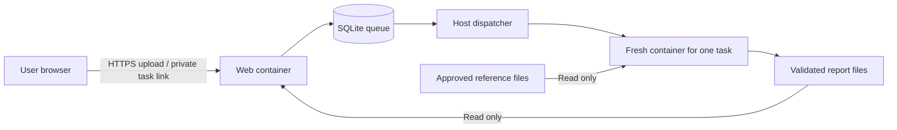

[Portal guide](../README.md) / Security and limits

# Security and resource limits

- [Private report access](#private-report-access)
- [Resource limits](#resource-limits)
- [Retention and deletion](#retention-and-deletion)
- [Submission data restriction](#submission-data-restriction)

## Isolation



The public container has no pipeline tools, reference mounts, Docker socket or compute work directory. It writes only incoming uploads and task metadata, and reads published reports. The dispatcher validates stored options again, takes a private copy of each regular uploaded file without following symlinks, and launches a fresh container for that job.

Every compute container has its own working directory, no network, a read-only root filesystem, no Linux capabilities, `no-new-privileges`, and CPU/memory/process/file-size limits. It sees only that job's input, the workflow source, and approved reference directories mounted read-only. It does not receive the task database, signing key, email, SMTP credentials or other users' files. The trusted host dispatcher has Docker access; compromise of that dispatcher or the host is outside the container isolation boundary.

FASTQ and gzip validation runs inside the isolated container, checks four-line records, IDs, sequence/quality lengths and characters, duplicate IDs, expanded size and read count. BEDs are normalized to coordinate columns and checked against the chosen assembly. Configuration fields are allowlisted and bounded; users cannot submit arbitrary YAML, regexes, shell commands, paths or URLs.

## Private report access

Task access uses unguessable authenticated links. The long-lived task credential is in the URL fragment, then sent in an Authorization header; it is not in the HTTP URL or access logs. The application does not set or accept authentication cookies and does not use localStorage or sessionStorage.

An authenticated task response provides read-only report and download links lasting at most one hour. Authorized report HTML renews these grants on its local figure and download links. Grants are scoped to one job and cannot access task metadata, cancel jobs or delete reports; deletion and retention are checked on every request. Missing or expired report grants direct document navigations to instructions for reopening the complete private task link.

These grants appear in report asset URLs; access logs are disabled and any added proxy must omit query strings from its logs. No-referrer and no-store headers also apply. Downloaded ZIP files retain ordinary portable relative links.

Report HTML is served with a sandbox Content Security Policy that prevents same-origin privileges and external connections, while allowing figure links to open in sandboxed tabs. Application HTML uses separate scripts and a stricter CSP.

Public portal pages, including the example index, allow Cloudflare Web Analytics when enabled at the proxy; beacons use the same-origin `/cdn-cgi/rum` endpoint. The application does not embed an analytics script. Private task pages and complete reports, including the example reports, retain their restrictive policies and use `Cache-Control: no-store, no-transform` to prevent automatic injection. This also keeps sample names in report paths out of analytics and avoids cross-origin failures from the report sandbox.

CSRF/origin checks, size limits, queue limits and per-address/per-client daily quotas apply to submissions. SQLite writes use transactions and parameterized queries.

## Resource limits

Both services load operator settings from one private `runtime/limits.yaml`. New deployments include the 24 common upload, queue, storage and compute settings. Omitted HTTP, temporary-filesystem and logging settings use the shared defaults in [limits.py](../ont_portal/limits.py); they can still be added to `limits.yaml` to override those defaults. Existing full configuration files remain supported. The following are repository defaults; operators may override them. The public server can have different limits.

| Setting | Default |
| --- | --- |
| FASTQ upload | 50 MB per file (50,000,000 bytes) |
| Files per batch | 16, reserved together in one transaction |
| Expanded FASTQ | 250 MB / 250,000 reads |
| BED upload | 4 MiB / 100,000 regions |
| Concurrent compute jobs | 2 across local and remote submissions; rules remain serial within each job |
| Ordinary job resources | 2 CPUs / 8 GiB RAM / 128 processes |
| Large BWA-MEM2 / Minimap2 indexes | Index-aware memory budget, capped at 20 GiB |
| Web service | 0.5 CPU / 256 MiB RAM |
| Public edge | 0.25 CPU / 64 MiB RAM; at least 1,024 connections including upstream connections |
| Dispatcher service | 0.5 CPU / 512 MiB RAM |
| Runtime per job | 1 hour |
| Work files per job | 4 GiB monitored total / 1 GiB hard per-file limit |
| Job temporary filesystem | 512 MiB |
| Pending or running tasks | 32 globally; 16 per client address and, when provided, per email |
| Incoming reservations | 2 GB, including optional BED reservations |
| Minimum free disk | 10 GiB, plus the work allowance before starting a job |
| Free host memory before a job | Its budget plus other active reservations and 2 GiB |
| Submissions per client / optional email | 128 per 24 hours, including later deleted tasks |
| API requests / uploads in flight | 16 / 10 globally; 8 / 1 per client |
| Read-only resource requests in flight | 128 globally; 64 per client |
| Read-only resource rate | 1,200/min per client, burst 240; 6,000/min globally, burst 480 |
| HTTP request rate | 360/min per client, burst 120; 1,200/min globally, burst 160 |
| New submission requests at edge | 6/min per IP, burst 4; each batch can contain 16 files |
| Incomplete request headers | 10 seconds at edge |
| Upload request / idle timeout | 10 minutes / 20 seconds |
| Unfinished batch upload expiry | 3 hours after creation |
| Report size | 100 MiB per bundle; HTML pages at most 4 MiB |
| Total published report storage | 2 GiB |
| Administrator log | 10 MiB hard file-size limit per job |
| Report retention | 7 days after completion |

The batch endpoint accepts the entire batch or rejects it without creating any jobs. The browser uploads files sequentially, waits and retries when upload capacity is occupied, restores all batch links after a refresh, and polls active tasks every 10 seconds (30 seconds in a hidden tab). Completed tasks are checked every 20 minutes to refresh report links; opening an expired link from the task page also renews it on demand. Rate-limited polling pauses according to `Retry-After` and adds jitter; it does not retry a non-idempotent submission automatically.

The dispatcher holds an exclusive supervisor lock and launches at most two isolated job processes. A transactional claim checks the global task count and reserves the combined memory, work disk and report capacity before starting another task. It waits for memory, disk and report-storage headroom before claiming the next task. Per-job containers enforce CPU, RAM, swap and process caps.

BWA-MEM2 and Minimap2 jobs estimate their memory budget from the selected reference index: small genomes use the 8 GiB default, while larger genomes can require up to 20 GiB. Default chromatin jobs use Bowtie2 with the smaller budget. The service does not change the chosen aligner to save memory.

For files above the online limits, the UI links to [ONT-LibQC on GitHub](https://github.com/Shall-We-Dance/ONT-LibQC). `pipeline_url` in the same limits file controls this link.

### Change limits

To change upload or batch limits later, edit `runtime/limits.yaml` rather than frontend code, then regenerate edge configuration with `service.py harden`. For example:

```yaml
max_upload_bytes: 50000000
max_files: 16
max_pending_per_client: 16
max_pending: 32
max_jobs_per_day: 128
max_concurrent_jobs: 2
max_concurrent_uploads: 10
max_uploads_per_client: 1
cores: 2
memory: 8g
max_memory: 20g
```

`max_files` can be set from 1 to 64. Keep `max_pending_per_client`, `max_pending` and `max_jobs_per_day` at least as large as `max_files`, and allow enough `max_reserved_bytes` for the intended queue. Increasing a batch limit does not increase compute concurrency. `max_concurrent_jobs` controls the analysis ceiling; `max_concurrent_uploads` controls the global upload ceiling and `max_uploads_per_client` controls fairness. Gzip expansion and read-count limits remain independent. Apply changes when no tasks are active by recreating the web container and restarting the worker:

```bash
docker compose -f /srv/ont-qc/runtime/compose.yaml up -d --force-recreate web edge
systemctl --user restart ont-qc-portal-worker.service
```

CPU, memory, process count and per-file size are hard container limits. Aggregate work-directory size is checked periodically; use filesystem/project quotas as well if your deployment requires a strict aggregate disk limit.

Rate limits are not a substitute for institution-wide traffic filtering or DDoS protection. A submission code can restrict expensive analyses to invited users. Keep one Uvicorn process and one dispatcher per runtime; the in-memory HTTP concurrency and request-rate limits are per process. IPv6 application quotas use a /64 network to reduce address-rotation bypass. The edge also enforces global request and connection bounds before forwarding to the application. The hardened web container limits open file descriptors to 1,024 to bound connection overhead.

Admission quotas persist in SQLite, survive report deletion and service restarts, and retain pseudonymous counters for only 24 hours.

## Retention and deletion

Successful, failed and cancelled jobs all remove their uploaded reads and calculation directory. Only successful report artifacts and bounded administrator logs remain. No BAM/SAM/FASTQ or alignment intermediates are offered in report downloads. Expired reports and logs are removed automatically; the retained task tombstone has its email, original filename, configuration and client identifier removed. Users can request earlier report deletion from their task page. A service interruption fails the active task safely; queued tasks survive restart. An interrupted upload can be cancelled and resubmitted.

## References

Security design references: [OWASP denial of service](https://cheatsheetseries.owasp.org/cheatsheets/Denial_of_Service_Cheat_Sheet.html), [Nginx request limits](https://nginx.org/en/docs/http/ngx_http_limit_req_module.html), [OWASP file uploads](https://cheatsheetseries.owasp.org/cheatsheets/File_Upload_Cheat_Sheet.html), [OWASP CSRF prevention](https://cheatsheetseries.owasp.org/cheatsheets/Cross-Site_Request_Forgery_Prevention_Cheat_Sheet.html), [Docker service controls](https://docs.docker.com/reference/compose-file/services/).

## Submission data restriction

The public portal must not receive human patient data (including de-identified patient data) or other sensitive or identifiable personal data. This applies to FASTQ files, custom BED files, filenames, and sample names. Users must actively check the separate data acknowledgment for each submission. Both `POST /api/jobs` and every file entry in `POST /api/batches` require the JSON boolean `data_policy_acknowledged: true`, in addition to `consent: true`. Missing, false, or non-boolean acknowledgments are rejected before job creation. Older clients must be updated. The acknowledgment is a user declaration; it does not inspect or certify the uploaded data.

The public example-input manifest includes download checksums. Publication checks cover file types, sizes, index sets, report links and paths. HMAC authenticates private task and read-only report links and pseudonymizes rate-limit identifiers.
